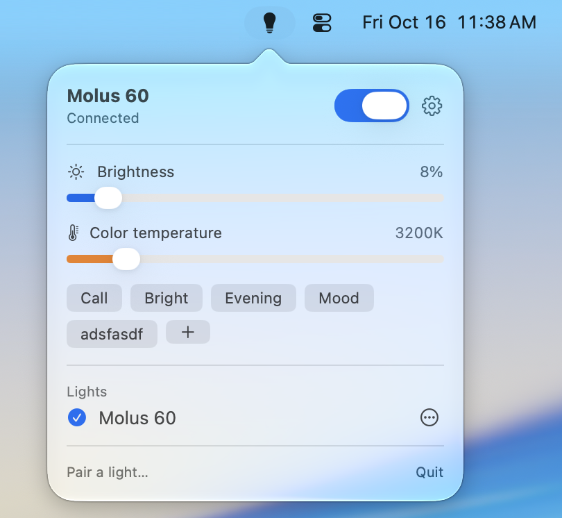

# VegaBar

Control your Zhiyun light from the Mac menubar.

<p align="center">
  
</p>

VegaBar is a small, native macOS app for Zhiyun's Bluetooth lights — the ones the ZY Vega phone app controls. It lives in the menubar, pairs directly with the light, and gives you power, brightness and colour temperature a click, a keystroke, a Shortcut or a shell command away. No phone, no cloud, no account.

I use a Zhiyun Molus G60 as a studio light in my home office, and it ticked me off that the only way to control it was to pick up my phone. There was no Mac app. So our mutual friend Claude and I decompiled the Android app, worked out the Bluetooth protocol, and built this in a few hours.

Requires macOS 14 or later; runs on Apple silicon and maybe Intel.

> VegaBar is an independent project, not affiliated with or endorsed by Zhiyun.

## Disclaimer

VegaBar is provided as is, without warranty of any kind, and you use it entirely at your own risk. It drives your lights over a reverse-engineered protocol that the manufacturer has not documented or approved. The author accepts no responsibility for anything that happens as a result of using it: a light that stops working, a pairing you can't undo, a house fire, a ruined video call, or any other consequence of your own decisions. If you aren't comfortable with that, don't use it. See the [LICENSE](LICENSE) for the legal version.

## Which lights?

I built and tested VegaBar with a single **Zhiyun Molus G60**. That is the only light it has ever been used with, and I have no idea whether it works with any other model. Other bi-colour Zhiyun lights that pair over Bluetooth Mesh use the same app and, as far as I can tell, the same protocol, so there's a reasonable chance — but it's untested, and RGB lights would need work that hasn't been done.

If you try it with something else, please open an issue and say what happened, either way. A frame log (Preferences › General › "Log Bluetooth frames to a file") is the most useful thing you can attach.

**Multiple lights and groups.** The protocol supports controlling several lights through one connection, and grouping them, and I'd like VegaBar to do that. With only one light to test against I can't build it blind. If you have two or more Zhiyun lights and would like to help test, get in touch through the issues.

## Features

**The menu.** Click the bulb for a power switch, brightness and colour-temperature sliders, your presets, and the list of paired lights. The icon itself tells you the state: lit when the light is on, outlined when it's off or at 0 %, slashed when it isn't connected.

**Gestures on the icon.** Scroll over it to dim or brighten. ⌥-click or right-click to toggle power without opening the menu.

**Presets.** Save a brightness and colour combination — "Call: 40 %, 4300 K" — and apply it with one click. Presets also show up in Shortcuts and the command line.

**Hotkeys.** Record global shortcuts for power, brightness up and down, and warmer and cooler, and choose how big each step is. They work from any app.

**Automations.**

- *Camera:* turn the light on whenever a camera is in use — FaceTime, Zoom, Meet, anything — optionally with a preset, and off again when the call ends. It restores whatever you had before.
- *Follow the Mac:* turn the light off when the Mac sleeps or the screen locks, and back on when you return.
- *Time of day:* drift from a cool daytime colour temperature to a warm evening one, blended over an hour at each end. Moving the slider yourself pauses it until the next transition.
- *Launch at login.*

**Shortcuts.** VegaBar's actions appear in the Shortcuts app, Siri and Spotlight: Turn Light On or Off, Set and Adjust Brightness, Set Color Temperature, Apply Preset, Get Status, Get Brightness, Get Color Temperature, and Is Light On. Wire them to Focus modes, Stream Deck buttons, or anything else that can run a Shortcut.

**Command line.** Install the `vegabar` tool from Preferences › General and script the light from Terminal, cron, Raycast or Alfred:

```text
vegabar status                light's state (add --json for scripts)
vegabar on | off | toggle     power
vegabar brightness 40         set brightness (%); +10 / -10 to nudge
vegabar cct 5600              set colour temperature (K); +300 / -300 to nudge
vegabar preset Call           apply a preset
vegabar presets               list presets
vegabar identify              make the light blink
```

It launches VegaBar if it isn't running, and the exit status tells you whether the command worked.

**URLs.** Anything that can open a link can control the light: `vegabar://on`, `vegabar://off`, `vegabar://toggle`, `vegabar://brightness/40`, `vegabar://brightness/+10`, `vegabar://cct/5600`, `vegabar://preset/Call`, and `vegabar://preferences`.

**Built to be safe.** Every command goes through a safety check right before it reaches the light: only the handful of commands VegaBar needs are allowed, values are held to the light's real ranges, and changes are rate-limited so nothing can strobe it — whether the request came from the menu, a script or an automation.

**Private.** VegaBar makes no network connections and collects nothing. Bluetooth is used only to talk to your lights.

## Install

**Download:** get `VegaBar.zip` from the [latest release](../../releases/latest), unzip it, and move `VegaBar.app` to your Applications folder.

Releases aren't notarized yet, so macOS will refuse to open the app the first time:

1. Double-click VegaBar. macOS says it can't verify the app. Click **Done**.
2. Open **System Settings › Privacy & Security**, scroll down, and click **Open Anyway** next to the VegaBar message.
3. Confirm, then allow Bluetooth access when asked.

(Or, from Terminal: `xattr -d com.apple.quarantine /Applications/VegaBar.app`.) If you'd rather not do that, [build it yourself](DEVELOPMENT.md); a locally built app needs none of it.

**Homebrew:**

```bash
brew install --cask dasmart/tap/vegabar
```

## Pairing a light

A Zhiyun light can be paired with only one controller at a time, so it has to leave the phone app's network before VegaBar can pair with it.

1. **Reset the light's pairing:** press the light's power button three times quickly. (You can also unpair it from inside the ZY Vega app.) The light is now in pairing mode.
2. Click the VegaBar icon and choose **Pair a light…**. The light appears within a few seconds.
3. Click **Pair**. The light blinks while it's being identified, then shows up in the menu.

To go back to the phone app later, either unpair the light from VegaBar (the ⋯ menu next to its name) or triple-click its power button again, then pair it in the phone app. Pairing state is kept in `~/Library/Application Support/VegaBar`; back that folder up if you don't want to factory-reset the light after moving to a new Mac.

## Tips

- **Bluetooth stuck?** If VegaBar stops connecting after being force-quit mid-connection, turn Bluetooth off and on.
- **Battery:** lights that report a battery level show it in the menu. The Molus G60 doesn't.
- **Something not working?** Preferences › General has a switch to log every Bluetooth frame to a file, which is the most useful thing to attach to an issue.

## For developers

Building, testing, how the protocol and pairing work, where data lives, the architecture, releasing and contributing: see [DEVELOPMENT.md](DEVELOPMENT.md). The wire protocol is documented in [PROTOCOL.md](PROTOCOL.md).

## License

MIT. See [LICENSE](LICENSE).